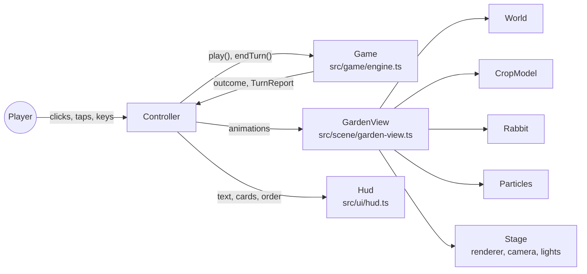
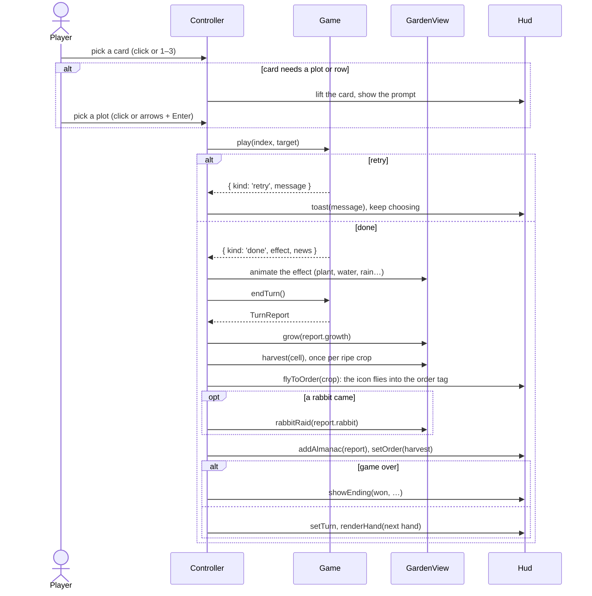
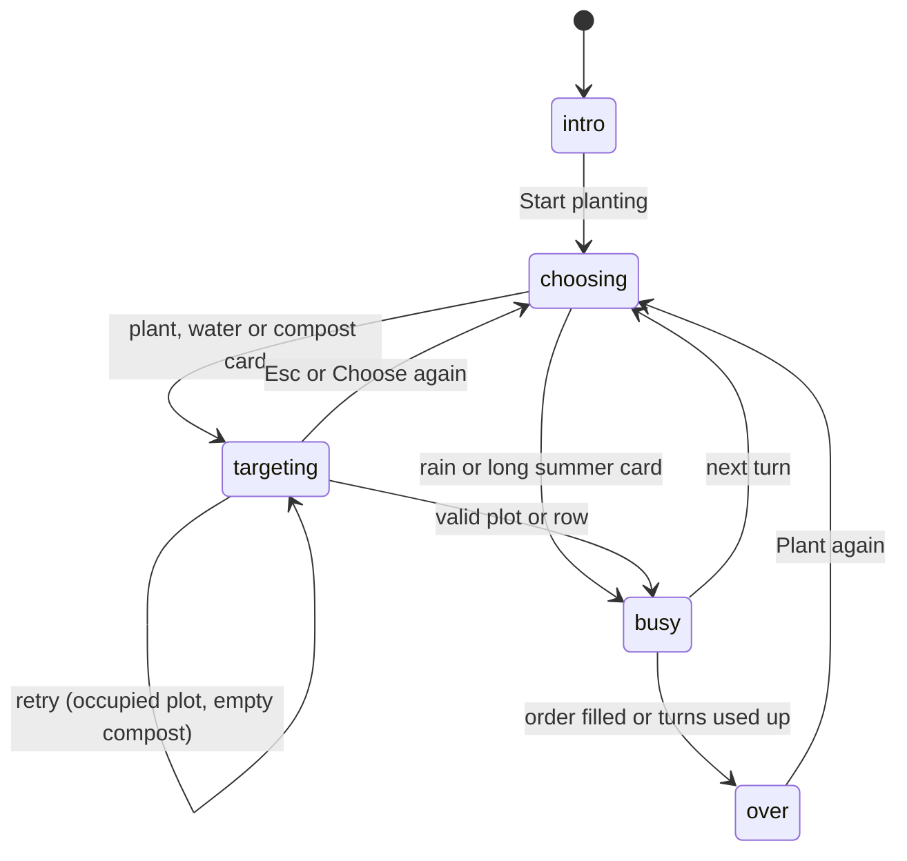

# Architecture

The game has three layers that each do one job:

- **Rules** (`src/game/`) decide what happens. Plain TypeScript, with no DOM or three.js, so it runs
  in tests.
- **Scene** (`src/scene/`) shows what happened in the 3D garden.
- **HUD** (`src/ui/`) is the 2D layer on top: cards, the order tag, the almanac, tooltips and the
  start and end sheets.

`src/controller.ts` connects them. It takes the player's input, asks the rules engine for the
result, then plays the matching animations and updates the HUD.



**The engine decides and the view animates.** By the time an animation starts, the game state has
already changed. Animations only show the result and never change the rules.

## Start-up and the render loop

`src/main.ts` creates the pieces in order:

1. `Stage`: the WebGL renderer, camera and lights. If WebGL isn't available, the page shows a
   message instead of the game.
2. `GardenView`: builds the island, plots, fence and decorations.
3. `Hud`: writes the 2D markup into `#hud`.
4. `Controller`: creates a `Game` (which deals the first hand), wires up input and shows the start
   sheet.

Then one `requestAnimationFrame` loop runs for the life of the page:

```ts
tick(now);                  // advance every running tween
view.update(now / 1000, dt); // idle motion: swaying crops, twinkling soil, drifting clouds, particles
stage.render();              // draw the 3D scene, then the CSS2D labels
```

## The rules engine

`src/game/config.ts` holds the settings, in the same shape as the original `GARDEN_KIT`, `CARDS`,
`DECK` and garden. `src/game/engine.ts` holds the `Game` class.

### `Game` API

```ts
const game = new Game(rng?);    // deals the first hand
game.hand;                      // Card[]: three different cards
game.play(handIndex, target?);  // use one card
game.endTurn();                 // growth, harvest, rabbit, win check; deals the next hand
```

| Member | Type | Meaning |
|---|---|---|
| `garden` | `Plot[][]` | `{ soil, crop, stage }` for each plot, `garden[row][col]`, zero-based |
| `harvest` | `Record<CropType, number>` | Crops picked so far |
| `turn`, `turns` | `number` | Current turn and total turns (Long summer raises `turns`) |
| `won`, `over` | `boolean` | `over` is the original loop condition negated: `won \|\| turn > turns` |
| `cardPlayed` | `boolean` | True between a successful `play()` and `endTurn()` |
| `plotAt(cell)`, `isEdge(cell)`, `needs(crop)` | helpers | Used by the tooltips |

`play()` returns one of two outcomes:

```ts
{ kind: 'retry', message: 'Nothing is growing there.' }  // nothing changed, choose again
{ kind: 'done', card, effect, news }                      // the card was used
```

`effect` tells the view what to animate: `plant`, `wasted` (seed on stone), `water`, `rain`,
`compost` or `summer`, with the cells involved.

`endTurn()` returns a `TurnReport`:

```ts
{
  turn: 3,
  action:     { icon: 'water', text: 'You watered row 2.' },
  growth:     [{ row: 1, col: 1, crop: 'pumpkin', start: 2, from: 3, to: 4, needs: 5, harvested: false, text: '…' }],
  growthNews: { icon: 'grew', text: 'Every crop grew: 1 stage on plain soil, 3 on rich soil.' },
  rabbit:     null,  // or { ate: { row, col, crop } | null, edgeCrops, news }
  harvest:    { carrot: 1, tomato: 0, pumpkin: 0 },
  won: false,
  over: false,
}
```

In each growth entry, `start` is the stage at the start of the turn, or `null` if the crop was
planted this turn ("new"). `from` is the stage after the card was played, and `to` is the stage
after soil growth. `Game.newsLines(report)` turns a report into the same lines `mystery.js` printed.

### Randomness

The constructor takes an optional `rng(purpose)` function. `purpose` is `'deal'`, `'rabbit'` or
`'rabbitTarget'`. The game uses `Math.random()` when none is given. Tests pass scripted values for
each purpose, which is how they replay the worksheet's season exactly.

## One turn, start to finish



### Controller modes



Input is ignored while the mode is `busy`, so the player can't act during animations.

## The scene

### Camera and framing: `stage.ts`

- An **orthographic camera** at 30° around and 41° up gives the 2.5D look. Objects don't shrink with
  distance, and rows still read back to front.
- `resize()` fits a region of `FIT_WIDTH × FIT_HEIGHT` world units into the space between the top bar
  and the cards. The HUD reports those heights through `setInsets()`. Phones use the narrower
  `FIT_WIDTH_NARROW`, so the plots stay a usable size.
- `pick()` raycasts from the pointer into each plot's invisible hit box. `toScreen()` turns a 3D
  point into pixels, used for the harvest icon that flies into the order tag.
- Lights: a hemisphere light for soft fill, and a warm directional "sun" with soft shadows. Tone
  mapping is ACES Filmic.

### Coordinates: `world.ts`

- Plot centres are `SPACING` (1.25) units apart, and each plot is `PLOT` (1.06) units wide.
- Columns run along **x** (left to right) and rows along **z** (back to front). `cellPosition({ row,
  col })` returns a plot's centre.
- Each `Bed` records its soil height (`top`), where crops stand. Stone is lower than the wooden
  beds.
- The world also builds the island, fence and gate, tent and bunting, sunflowers, hay bales, tree,
  grass, clouds, and the row and column number labels.

### Crops: `crops.ts`

`CropModel` builds a low-poly carrot, tomato or pumpkin. `setProgress(p)` takes `p` from 0 (a seed
was just planted) to 1 (ripe) and reshapes the model. For example, tomatoes turn from green to red
and pumpkins swell and turn orange. Each crop has a plant-marker tag (a `CSS2DObject`) showing
"2/4" with a small progress bar.

### Rabbit, particles and tweens

- `rabbit.ts`: a low-poly rabbit with `appear`, `hopTo` (an arc with squash and stretch), `munch`,
  `lookAround` and `vanish`.
- `particles.ts`: one `InstancedMesh` of up to 1,200 small pieces for water drops, rain streaks,
  compost flakes, dust and sparkles. Each piece has its own velocity, gravity, drag and lifetime.
- `tween.ts`: `tween(ms, update, ease)` returns a promise, so animations read top to bottom with
  `await`. Durations are shortened when the system asks for reduced motion.

`garden-view.ts` puts these together into one method per event: `plant`, `wasted`, `water`, `rain`,
`compost`, `summer`, `grow`, `harvest` and `rabbitRaid`.

## The HUD

`Hud` (`src/ui/hud.ts`) writes its markup once, then updates parts of it:

| Part | Methods |
|---|---|
| Turn plaque with a pip for each turn | `setTurn` |
| Fair order tag | `setOrder`, `flyToOrder` |
| Seed-packet cards | `renderHand`, `setHandEnabled`, `selectCard` |
| Prompt and toasts | `setPrompt`, `toast` |
| Plot tooltip | `showTooltip`, `hideTooltip` |
| Almanac | `addAlmanac`, `clearAlmanac` |
| Start and end sheets | `hideIntro`, `showEnding`, `hideEnding` |

The HUD sits in front of the canvas with `pointer-events: none`, and only its buttons and panels
turn pointer events back on, so clicks on empty space reach the garden.

Icons in `src/ui/icons.ts` are inline SVG strings. They replace the console version's emoji, which
look different on every system.

## Styling

`src/style.css` starts with colour and font tokens on `:root`. The scene's matching colours are in
`src/scene/palette.ts`. The game commits to one daytime look rather than a light and dark theme.

## Accessibility

- Every action works from the keyboard: `1`–`3` pick a card, the arrow keys move a plot cursor,
  `Enter` confirms and `Esc` cancels.
- Cards are real `<button>` elements with labels. The turn plaque, toasts and end sheet use
  `aria-live`, so screen readers announce changes.
- When reduced motion is on, tweens run at about a third of their length and CSS animations are
  turned off.
- Messages explain what happened, such as "Nothing is growing there." Tooltips warn before a move
  that wastes a turn, such as planting on stone or watering an empty row.
